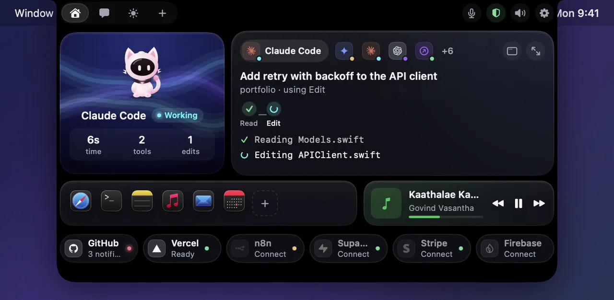
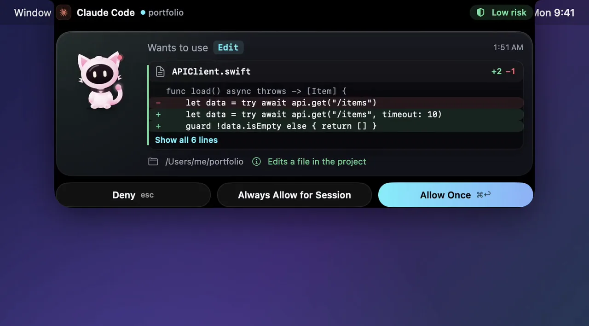
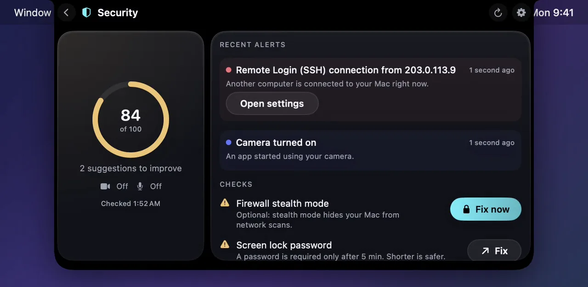
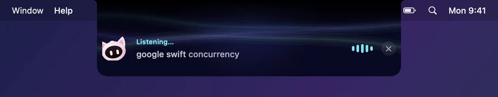
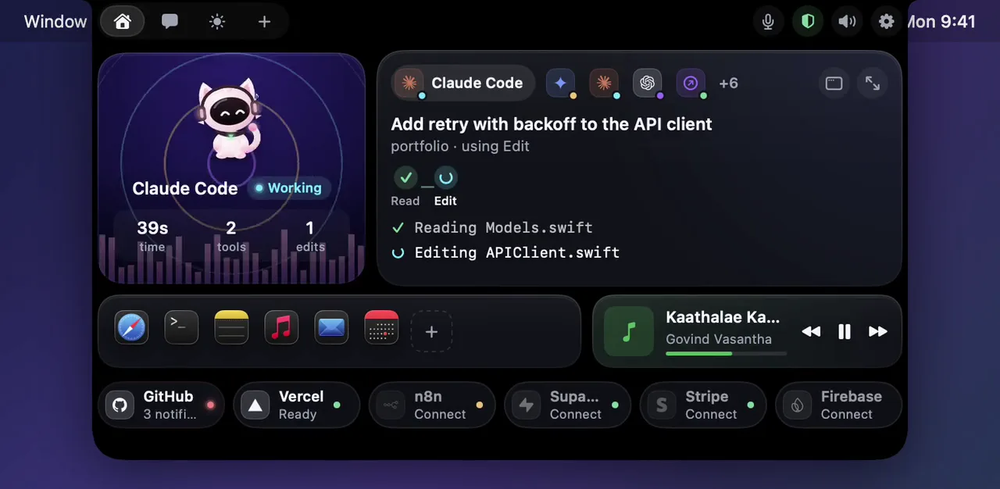

# SASU Notch AI: Nova, your AI companion in the notch

**Website:** https://ravirajsarangan.github.io/SASU-NOTCH-AI/ · **License:** MIT · open source

Nova lives in your MacBook notch. It watches your coding agents (Claude Code, Codex, Cursor, Gemini CLI), shows every change before you allow it, guards your Mac, talks with you ("Hey Nova", English and Tamil), and looks after your day: calendar, reminders, routines, WhatsApp, music and a usage meter for your AI plans.

<p align="center">
  <a href="https://ravirajsarangan.github.io/SASU-NOTCH-AI/"></a>
</p>

| Approve a change, with the diff | Nova Guard |
|---|---|
|  |  |
| **“Hey Nova”** | **Dances to your music** |
|  |  |

<p align="center"><sub>Real frames from the app, recorded with demo data. Watch them move on the <a href="https://ravirajsarangan.github.io/SASU-NOTCH-AI/">website</a>.</sub></p>

Native macOS (15+) app in Swift 6 / SwiftUI. It needs only the Command Line Tools; Xcode is not required.

**Privacy.** Everything runs on your Mac. Speech is recognised on-device. Agent activity, security data, calendar and logs never leave it. Only text you send to an AI provider you chose goes out, with secrets masked. API keys live in your macOS Keychain.

**Security (Nova Guard).** It watches who gets in (SSH, Screen Sharing, failed logins, new admins and SSH keys), what starts by itself (startup items, profiles, cron, sudoers, shell files), your defences (FileVault, Firewall, Gatekeeper, SIP, updates, screen lock) and which app uses the camera or microphone. Safe fixes are automatic and undoable; reverse shells and `curl | sh` from agents are always blocked. Ask “Hey Nova, check my system” any time.

**Safety.** Voice and automations can deny an agent request but never approve one. Anything that sends, deletes, buys or changes settings waits for your click or a spoken "send"/"go". No app can promise complete protection; Nova Guard watches the most common ways in.

## Build & run

```sh
scripts/build_app.sh && open build/Nova.app   # release build → build/Nova.app
swift run Nova --snapshot /tmp/nova-snaps      # debug: render every screen to PNG
swift run Nova --sound-test                    # debug: play every sound
```

Nova lives in the menu bar (✨) and in the notch. Hover over the notch to peek. Click it to open Home. Esc closes it.

On first launch a short onboarding walks you through setup; reopen it any time from ✨ → Show Onboarding…. Settings (✨ → Settings…, or ⌘,) has 11 sections: General, Appearance, Nova, AI Providers, Agents, Integrations, Automations, Notifications, Privacy, Advanced and About.

- **macOS notifications** can be turned on or off per event. Permission requests carry **Allow Once / Deny** buttons.
- **Advanced** has a "Simulate an agent session" demo, a test notification, and a button that plays every sound.

## Release

```sh
scripts/release.sh        # universal (Apple Silicon + Intel) build → build/release/Nova-<version>.zip / .dmg + SHA256SUMS
python3 scripts/make_icon.py   # regenerate Assets/AppIcon.icns
```

The version comes from `VERSION` and the build number from the git commit count. Builds are ad-hoc signed and **not notarized**, because no Apple Developer ID is configured. On another Mac, open Nova the first time with right-click → Open. Logs are in Console.app under `app.nova.companion`.

## What's inside

| Area | Where |
|---|---|
| Notch window, states, layout | `Sources/Nova/Notch`, `App/NotchState.swift` |
| Mascot: pose art + live eyes + effects | `Sources/Nova/Character`, art from `scripts/prepare_mascot.py` / `prepare_poses.py` |
| Agent monitoring (socket, sessions, permissions) | `Sources/Nova/Agents`, `Features/Sessions`, `Features/Permissions` |
| Claude Code hook helper | `Sources/NovaHook` (`nova-hook`) |
| AI chat (Anthropic, OpenAI, Gemini) | `Sources/Nova/AI`, `Features/Chat` |
| Morning brief (Gmail, LinkedIn emails, YouTube) | `Sources/Nova/Automations/Brief`, `Features/Brief` |
| WhatsApp drafts & good-morning messages | `Sources/Nova/Automations/WhatsApp` |
| Shared logic (no UI) | `Sources/NovaKit` |

## Connect Claude Code

```sh
scripts/install_claude_hook.sh --dry-run   # preview the hook entries
scripts/install_claude_hook.sh             # install (backs up ~/.claude/settings.json first)
scripts/uninstall_claude_hook.sh           # remove
scripts/send_test_event.sh demo            # fake a session without Claude
```

The hook sends events to `~/Library/Application Support/Nova/nova.sock` (mode 0600, current user only).

- **Permission requests** (Claude Code's `PermissionRequest` hook) wait for your click in Nova.
- **No answer:** after 120 s, Claude Code shows its normal prompt.
- **Nova not running:** the hook exits silently, so nothing changes.
- **It never approves anything on its own.** "Always allow for session" is unavailable for high-risk commands.
- **Not covered:** `PermissionRequest` doesn't fire for MCP tools marked `requiresUserInteraction`.

## Integrations (GitHub · Vercel · n8n · Supabase · Stripe · Firebase)

Open Settings → Integrations and paste a token for each service; tokens are stored in the Keychain. Nova refreshes them every minute while it's visible. If a deploy, workflow or service starts failing, Nova shows a banner. Tap a chip on Home for details.

| Service | What to paste |
|---|---|
| GitHub | Classic personal access token with `repo`, `notifications` and `workflow` |
| Vercel | Account token (plus a team ID for team projects) |
| n8n | Your n8n URL plus an API key |
| Supabase | Management access token (`sbp_…`) |
| Stripe | A **restricted, read-only** key. Only amounts, statuses and times are read. |
| Firebase | Nothing to paste: it uses your Google sign-in. Reconnect Google once to grant read-only Firebase access. |

## Your apps

- **Dock:** pinned apps show with their real icons and a dot when they're running. Click to open or switch; right-click for Hide, Quit or Remove. Choose the apps in Settings → General.
- **Spotify:** the track shows automatically. Play, pause and skip need a one-time "control Spotify" approval from macOS.
- **VS Code:** Claude Code sessions started in VS Code (or Cursor) are tagged "in VS Code". To see VS Code's own activity (tasks, debugging, errors), run `scripts/install_vscode_extension.sh`, then reload VS Code. GitHub Copilot has no activity API, so it can't be shown.

## AI keys

Open Settings (⌘, from the menu bar) → AI Providers. Keys are stored only in the macOS Keychain.

## Automations

All setup is in Settings → Automations.

### Morning brief

1. Create a Google Cloud **Desktop app** OAuth client.
2. Enable the Gmail API, YouTube Data API v3 and YouTube Analytics API.
3. Add yourself as a test user.
4. Paste the client ID and secret into Nova, then click **Connect Google**.

The scopes are read-only. LinkedIn updates are read from LinkedIn's notification emails; there's no scraping.

### WhatsApp

This uses WhatsApp for Mac.

- **Reading:** Nova reads its local database read-only, and only for the contacts you add.
- **Sending:** Nova opens the chat with the message filled in, then presses Return. Pressing Return needs the **Accessibility** permission.
- **Test mode is on by default:** messages are filled in but never sent. Turn it off when you're happy with the drafts.
- **Reply drafts** are never sent without your click.
- **Good-morning messages** go out automatically after a 5-minute review window (Skip and Edit are available). After 11:00 they're skipped for the day.

Privacy note: drafting sends the selected contacts' recent messages to your chosen AI provider. Automating WhatsApp is unofficial, and WhatsApp could change its app or its rules.

## Contributing

Issues and pull requests are welcome. Build with `scripts/build_app.sh` before sending a change, keep slow work off the main thread (see `HardwareRunLoops`), and never let voice or automations approve anything.

## License

MIT. See [LICENSE](LICENSE).

